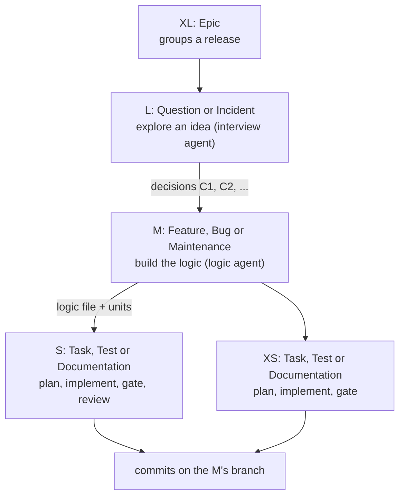

# Fugue design

This folder is the written record of how the rebuilt Fugue is meant to work: what has been decided, what is built, and what is still open. It was written from the whole conversation that produced the rebuild, including every instruction the developer gave, so that nothing agreed is lost.

The rebuild lives on the `refactor` branch. The old code is parked in `src-temp/` (git-ignored) and is read for ideas only. New code goes in `src/fugue/`.

## How to read it

Every statement carries one of three marks.

- **Built**: it exists in `src/fugue/` and was exercised.
- **Agreed**: the developer decided it, and it is not built yet.
- **Open**: a question that is still to be settled, or a place where the code and the decision disagree.

Where a statement quotes the developer, it is marked as theirs. Where it is a recommendation that was accepted, it says so.

## The model in one picture

- An **L** ticket explores an idea with the developer and decides. It creates **M** tickets and nothing else.
- An **M** ticket builds the logic of one feature, one bug fix or one piece of maintenance. It offers a few versions, the developer picks, and it creates **S** and **XS** tickets.
- An **S** or **XS** ticket is a unit of work. It always has an M above it. It is planned, implemented and gated automatically, and an S is also reviewed. Its work is commits on the M's branch.
- `fugue work N` always works exactly one ticket. What it does depends on the ticket's type.

## Running it

From the repository root, `uv tool install --editable .` puts `fugue` on the path and runs from `src/`. Without installing, `uv run fugue ...` works from the checkout. `fugue work N --help` lists the options. It needs `GITHUB_TOKEN` in the environment, with the `project` scope for project fields.

## Index

1. [Principles and architecture](principles.md): the goal, the rules the developer set, the libraries and why.
2. [The work model](work-model.md): the hierarchy, types, sizes, pipelines, promotion, what the plan carries, how information passes down.
3. [Agents](agents.md): the five roles, their prompts, the tools they use to ask the developer, the outputs they must write and the templates they follow.
4. [Flows](flows.md): what `fugue work` does for an L, an M, an S and an XS, step by step.
5. [Branches, commits and pull requests](branches-and-commits.md): one branch per M, units as commits.
6. [Review and follow-ups](review-and-follow-ups.md): blocking and non-blocking findings, and where non-blocking ones are filed.
7. [The interface](interface.md): the terminal screen, the questions, run states, headless and automatic runs.
8. [Settings](settings.md): the layers, `fugue config`, and every setting.
9. [The GitHub layer](github-layer.md): what exists, what is missing.
10. [Status, decisions and open points](status-and-open-points.md): what is built, the decision log in order, and every open question.

## Conventions used in this folder

- Each paragraph and list item is one line. Prose is not wrapped at a column.
- No emojis.
- Terms follow [GLOSSARY.md](../../GLOSSARY.md) where it defines them. New terms in this folder are defined in the document that introduces them.
