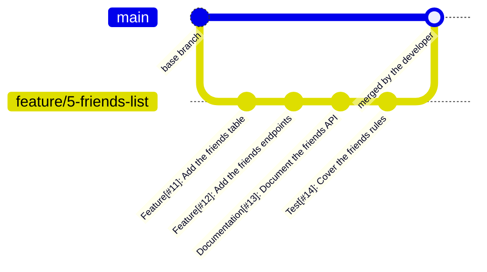

# Branches, commits and pull requests

## One branch per M

**Agreed.** An M ticket creates the branch, and units are commits on it. The developer's words: "M -> creates the branch like feature/5-... bug/5-... maintenance/5-... AND S/XS are no longer separate branches, they are commits on that branch". The branch is per M and not per L any more: "Yes i want the branch to be per M not L any more."



- The name is `<type>/<M>-<slug>` with the type in lower case: `feature/5-...`, `bug/5-...`, `maintenance/5-...`. The slug is the title cut at 40 characters, as the existing branches are named.
- It starts from the current head of the base branch. The base is the repository's default branch (`develop` here) unless `work.base_branch` says otherwise. `work.base_branch` is local-only.
- `fugue work M` creates the branch when it creates the units. **Open.** Whether it is pushed at that moment or by the first unit.
- **Built, older form.** Today `PrepareBranch` creates a branch per ticket named `<issue type>/<number>-<slug>`. That is the form to be replaced: a unit no longer has a branch of its own.
- Stacks are not used inside an M. A stack was a chain of pull requests with each targeting the one below. Units are commits, so ordering is the order of the commits.

## One worktree per M

**Agreed, to build.** All units of an M work in one worktree, on the M's branch. The worktree is in the repository, under `.worktrees/`, in a folder named like the branch. The developer: "fugue work #1 opens worktree here: ~/Coding/fugue/.worktrees/feature/1-dafsafs, and also add .worktrees in gitignore".

**Built.**

- The default is `<repository root>/.worktrees/<branch>`. `.worktrees/` is git-ignored.
- `work.worktree_root` moves the root. The folder under it is still named after the branch.
- Git's internal name for the worktree is the whole branch with `/` turned into `-` (`feature-1-title`), so branches that end the same way never clash. Removing a worktree finds it by its path.
- Running again reuses a worktree that already exists for the branch, so a run can resume.
- **A finding.** If the branch is already checked out in a worktree somewhere else, that worktree is reused wherever it is. This is why a run in `fugue-tester` reused an old worktree in `fugue-tester-worktrees/`. **Open.** Say so on the screen when a worktree outside the configured root is reused. It was offered and has not been answered.

**Agreed.** Units of one M run one at a time, because they share a worktree, so a run takes a lock on it. Units of different Ms run in parallel. **Open.** Where the lock lives.

## Units are commits

The developer's sketch:

```text
feature/5-...
 commits:
  1. (carries the M tag, NOT Task)[#1]: ...
  2. Feature[#1]: ...
  3. Documentation[#1]: ...
  4. Test[#1] ...
```

**Agreed reading, confirmed by the developer.** The number in brackets is the unit's own ticket number, so each unit links to its commits.

- A **Task** unit commits with the **M's type tag**: `Feature[#12]: ...` on a feature branch, `Bug[#12]: ...` on a bug branch, `Maintenance[#12]: ...` on a maintenance branch.
- A **Test** unit commits as `Test[#13]: ...`.
- A **Documentation** unit commits as `Documentation[#14]: ...`.
- The pull request title is the M's: `Feature[#5]: ...`.

A bug fix has no unit type of its own. It is a Task unit that carries the Bug tag, and the regression test is a Test unit.

### Commits

These rules come from the project's own process documents and still hold.

- `<Issue Type>[#N]: <short explanation>`. The type must match exactly, capital letters included.
- Keep commits small and focused. A unit with several parts becomes several commits.
- Every commit body has a **Summary** (why the commit exists) and, when it touches more than one thing or the reason is not obvious, **Changes**: bullets of "what changed: why it changed".
- Never name an AI tool, a model or a provider in a commit message, an issue, a comment or a pull request. Use roles: orchestrator, implementation agent, reviewer.
- Merge commits, not squash, so each unit's tag stays in history.
- **Agreed.** The implementation agent never commits or pushes. Fugue does, after the gate passes and, for an S, after a clean review. That is enforced with a tool hook where the SDK allows it and not only by the prompt.

## The pull request

**Agreed, mechanism partly open.** One pull request per M, from the M's branch to the base branch.

- It opens as a draft after the first unit is pushed, because a pull request cannot exist before there is a commit. **Open.** The moment it is marked ready. The proposal is that the last unit's run marks it ready when every sibling is closed.
- It lists the units and any follow-ups that were filed, in the pull request's description.
- Only the developer merges. An agent may merge only when instructed for that exact head.
- The developer said the review of the M as a whole was "unrelated right now". An S unit is reviewed on its own commits, so no review is needed on the pull request itself for the moment.

## Review reads commits

**Agreed.** The S review reads the diff of the unit's own commits: the head before the unit's run against the head after it. It does not review the rest of the branch. The gate runs on the cumulative state of the branch, which checks the integration of the units for free.

## When a unit fails

**Agreed.** A failed or stopped unit leaves uncommitted changes in the shared worktree. A rerun continues from them, because every step is safe to repeat. Discarding them is an explicit command and is never automatic, because the same worktree holds earlier units' work and may hold changes the developer made.

## Drift from the base

**Open.** An M's branch lives for as long as its units take, and the base moves. A step that brings the base into the branch, and what to do on a conflict, is not designed. It is for later.
