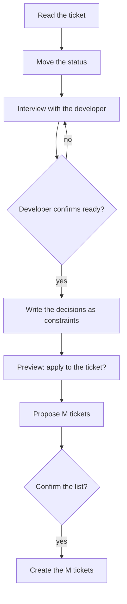
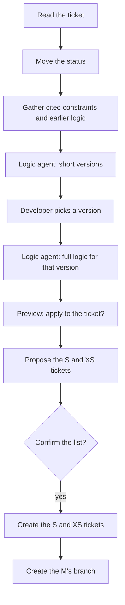
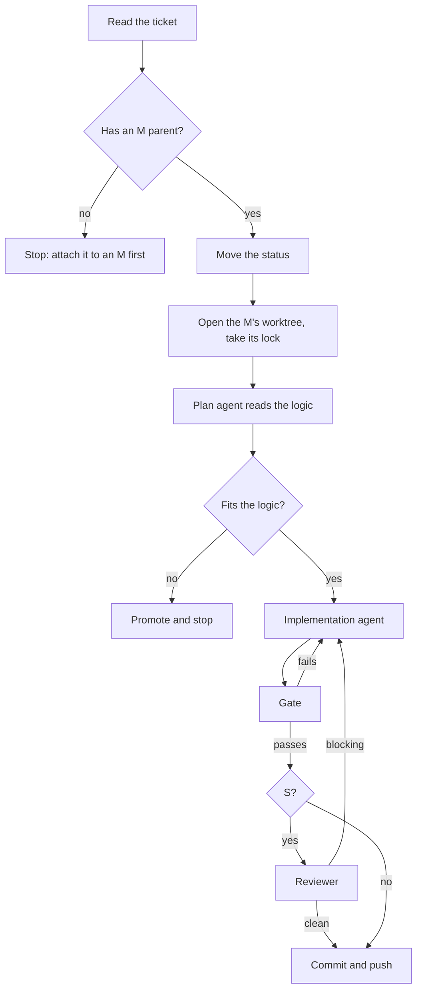

# Flows

`fugue work N` works one ticket. It reads the ticket's type, picks the flow for its tier, and runs it. The developer's words: "fugue work is still a SINGLE TICKET, we wont encapsulate multiple right now, thats a different command".

The flows are pydantic-graph graphs of class nodes. Each step reports `StepStarted` and `StepFinished`, and the checklist shows the steps ahead from the start.

## What is built today

**Built.** `fugue work N` reads the ticket's type and picks the flow (`core/work/route.py`):

| Type | Tier | Flow |
| --- | --- | --- |
| Epic | XL | Refused: an Epic is not worked. |
| Question, Incident | L | Stops with "not built yet". |
| Feature, Bug, Maintenance | M | Stops with "not built yet". |
| Task, Test, Documentation | S, XS | The unit flow. |

A ticket with no type, or a type with no flow, is refused with a message that says so.

The unit flow has these steps:

1. Read the ticket, and the project's fields for it. A closed ticket is refused, and so is one whose status is not `S0: To Do`. Its Size must be XS or S (it is asked when missing).
2. Check the parent. A unit must have a parent that is a Feature, Bug or Maintenance, and it must be open. When the M says `Builds on #N` and #N is still open, the run is refused until #N is closed, because the M's code would be missing from the base branch.
3. Lock the branch. The lock is a file in Git's own folder, so it never shows as a change. A branch worked by a live run is refused. A lock left by a run that is gone is taken over only when the developer says yes.
4. Prepare the branch and the worktree, for the M: `<type>/<M>-<slug>`. Fugue fetches the branch from origin. When it exists there and the worktree exists, the worktree is reset to it. When the worktree is missing it is created from it. When the branch is not on origin it is created from the base branch. A worktree with uncommitted changes, or a branch with commits origin does not have, is refused, so nothing local is lost.
5. The stages. XS goes through: start the analysis (S1), plan, mark ready (S2), start the implementation (S3), implement, gate. S adds start the review (S4) and review. The plan, implementation and review say "no agent set" and go on. The gate runs the configured checks. Because the run asks before each step, it can be stopped at S2 to read the plan.
6. Finish, and let go of the lock.

**Agreed.** The L and M flows below, and the agents of the unit flow.

## Before every step: the checkpoint

**Built.** Before each step except the first, the run asks "Continue with X?" (yes by default). The question is tagged as a permission.

- A **no** stops the run. The run is Stopped and not Finished. The same question is held back quietly, and the developer brings it up with `r` and can say no again as often as they like. A yes goes on. The status bar says "Stopped" and "press r to continue".
- `--auto` answers permission questions by itself with their default, says so ("yes (automatic)") and records it as automatic. Other questions are still asked.
- A terminal prompt cannot hold a question for later, so with `--headless` a no ends the process, the run stays Stopped, and running the command again continues, because every step is safe to repeat.

See [the interface](interface.md#run-states).

## The L flow: interview

**Agreed, not built.** For a Question or an Incident.

1. Read the ticket and its project fields.
2. Interview. The agent uses the question tools. It offers three to five directions and signals readiness. The developer confirms with "Start the analysis?" (default no), or keeps talking. Respect a turn limit if one is set (the old Fugue used 10).
3. Write the decisions as constraints with ids.
4. **Preview.** A floating window shows the Question response. On yes it is applied to the ticket, the conversation record is attached, and the ticket is refetched into the Ticket window.
5. Propose the M tickets as a table: title, type (Feature, Bug or Maintenance), one line of outcome, the logic it builds on, the constraints it carries, order. This table is not uploaded to the ticket.
6. The developer confirms the list. Creating tickets is an outward action.
7. Create the M tickets, each citing `Agreed in #<L>: C..`.

**Open.** Whether the created M tickets get the L as a native parent. A natural reading is yes, since the L created them. The L's own status and closing are not decided.

## The M flow: logic

**Agreed, not built.** For a Feature, a Bug or a Maintenance.

1. Read the ticket and its project fields. Gather the constraints it cites (`Agreed in #<L>: C2`) and any earlier logic it can build on, which the logic agent looks for with read-only ticket tools.
2. Logic agent, first job: a few short versions. Each has a diagram and only what differs from the others. It recommends one and says roughly how many units each takes. It may ask the developer when it cannot go on.
3. The developer picks. The recommended version is preselected. The developer: "mainly just picks".
4. Logic agent, second job: the full logic for the picked version, in the logic file.
5. **Preview.** The ticket's Analysis, Solution and Details are shown. On yes they are applied to the ticket, the logic file is attached, and the ticket is refetched. The developer's words: "a Preview floating window that asks do we approve of this analysis, if yes, its applied to the Ticket on github and its refetched to load it onto our Ticket window".
6. Propose the S and XS units: title, Task, Test or Documentation, size, the constraints each carries, what it depends on. XS is for work that needs no thought and S for work that needs a plan.
7. The developer confirms. Create the units with the M as native parent, blocked-by links, and `Agreed in #<M>: C..`.
8. Create the M's branch. See [Branches, commits and pull requests](branches-and-commits.md).

**Open.** Whether the preview approval is a permission, so that `--auto` approves it. The pick is a decision and is never automatic.

## The S flow and the XS flow: a unit

**Agreed, not built.** For a Task, a Test or a Documentation. Always automatic.

1. Read the ticket. Refuse it with a clear message when it has no M parent. A ticket in the backlog without a parent can be read but not worked until it is attached to an M.
2. Move the status.
3. Open the M's worktree. Units of one M run one at a time, so a lock is taken. Units of different Ms can run in parallel.
4. Plan. The plan agent reads the ticket and the logic it cites and writes the plan. It may promote the ticket (XS to S, S to M) and stop.
5. Implement. The implementation agent works on the M's branch and leaves uncommitted changes.
6. Gate. The configured checks run, every one even after a failure, and the output streams to the STDOUT and STDERR windows. A failure goes back to the implementer with the failing output, and the gate runs again. **Open.** The limit on repair rounds. In the earlier docs, reaching the repair limit re-sized an S to an M.
7. Review (S only). The reviewer reads the unit's own commits. A blocking finding goes back to the implementer, then the gate, then the review again, with no limit on rounds. A non-blocking one is filed. See [Review and follow-ups](review-and-follow-ups.md).
8. Commit and push. See [commit rules](branches-and-commits.md#commits).
9. Status, and the closing of the unit's ticket. **Open.**

**Built.** The gate step and its parts in the checklist. Everything else in this flow is not built.

### The gate

**Built.** The gate is a table of checks, a name and a command each, run in the worktree in order. It is set with `fugue config set work.gate '<json>'`, a `[work.gate]` table, or `FUGUE_WORK_GATE`. `work.gate_timeout` bounds one check (30 minutes by default). Every check runs even after one fails, so the result names everything wrong at once. A check that is not found counts as failed, a check that times out is stopped and failed, and the run stops with the failed checks named. Each check is a part of the step in the checklist. With no checks set the step says so and goes on.

## Previews, selections and what needs the developer

| Moment | Control | Automatic with `--auto`? |
| --- | --- | --- |
| Continue with the next step | yes or no | yes (a permission) |
| Pick an L's direction | ask, with Other | no |
| Pick an M's version | ask, with Other | no (a decision) |
| Approve an analysis preview | yes or no, with the preview as the body | **Open** |
| Confirm the list of tickets to create | form or table | **Open** |
| Missing Size | pick | no |
| Review follow-ups to file | yes or no | yes, to be tagged a permission |

## Run records

**Built.** Every event of a run is stamped with the run id and the flow, and appended to `.fugue/runs/<run id>.jsonl` in the repository. Questions and their answers are recorded, with an automatic answer marked. The folder can be moved with `work.runs_dir` and recording turned off with `work.record_runs`.

**Open.** Nothing reads the records back yet, so a run cannot be listed with its state or resumed from the step where it stopped. Today a rerun repeats every step, which is safe but wasteful for agent steps.
