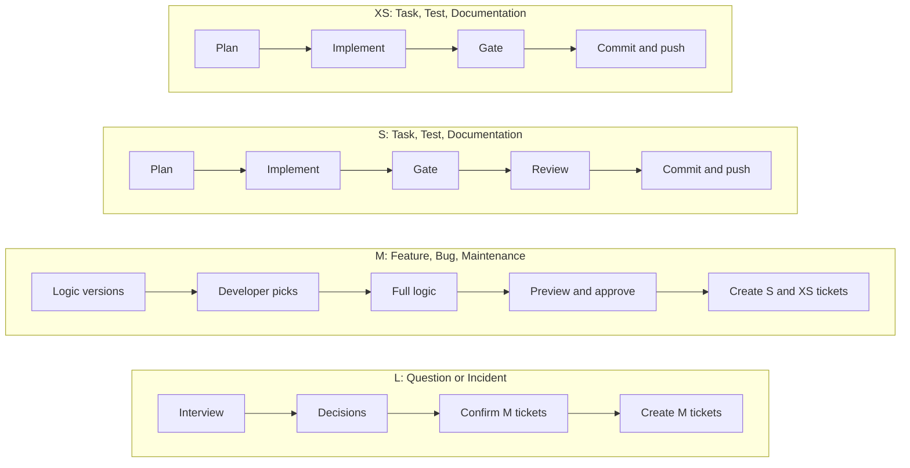

# The work model

This document defines the tiers of work, what each tier is for, which issue types belong to it, what it produces, and how information passes from one tier to the next. It is the model the developer arrived at after trying two earlier ones. See [the decision log](status-and-open-points.md#the-decision-log) for how it changed.

## The four tiers

| Size | Types | Kind of work | Agent | Produces | Code |
| --- | --- | --- | --- | --- | --- |
| XL | Epic | groups a release | none | nothing | no |
| L | Question, Incident | exploration | interview | decisions, and M tickets | no |
| M | Feature, Bug, Maintenance | logic | logic | the logic file, and S and XS tickets | no |
| S | Task, Test, Documentation | a unit of work, reviewed | plan, implementation, reviewer | commits on the M's branch | yes |
| XS | Task, Test, Documentation | a unit of work, not reviewed | plan, implementation | commits on the M's branch | yes |

**Agreed.** The mapping of types to tiers is the developer's: "XL -> Epic, L -> Question/Incident, M -> Feature/Bug/Maintenance, S/XS -> Task/Test/Documentation". All nine issue types of the project are used. The type decides the tier. Size only separates XS from S. A ticket whose type and size disagree (a Feature of size S, say) stops the run with a clear message.

Only S and XS tickets produce code. L and M tickets produce documents and tickets.

## L: the interview

An L ticket is exploratory. The developer's example: a new feature that might require libraries, or the foundation for something huge, is an L.

- **Agreed.** An interview agent explores the idea with the developer, using the question tools (see [Agents](agents.md#tools-for-asking-the-developer)).
- **Agreed.** It returns the record of the interview, the decisions, and a proposal of M tickets.
- **Agreed.** The proposal of M tickets is shown to the developer for confirmation and is not uploaded to the ticket. The developer's words: "the list of M tickets is not uploaded to the ticket".
- **Agreed.** An L creates M tickets only, never S or XS tickets. The developer's words: "No L can NOT create S and XS directly."
- **Agreed.** An Incident at L is explored the same way, with its own ticket template. Its M tickets are Bug or Maintenance tickets. A Bug explains the logic gap and gives example fixes.
- **Agreed.** The decisions are written as constraints with ids (C1, C2, and so on) so that later work cites an id and never copies the text.

## M: the logic

An M ticket builds the logic of one feature, one bug fix or one piece of maintenance. The developer's words: "Logic Question (Details Logic about how a feature/bug should work/get resolved)". Everything an L chooses is built on by an M, in terms of logic.

- **Agreed.** An M does not need an L above it. The developer's words: "logic feature can be developed on top of previous L level work".
- **Agreed.** When an M reuses logic that was built earlier, the logic agent names that ticket (`Builds on #N`). It does this only when that logic exists. This is a reference and never a copy.
- **Agreed.** The logic agent creates a few versions. The developer checks them and mostly just picks. The recommended version is preselected. After the pick, the full logic is written for the picked version only.
- **Agreed.** Flows and diagrams are key. The developer: "flows and diagrams will be KEY on this agent". The ticket carries the overview with a diagram, and the logic file carries the specifics.
- **Agreed.** `fugue work M` creates the S and XS tickets. It writes no code. The developer's words: "i want fugue work M to create the tickets, the actual work will be done with fugue work S/XS".
- **Agreed.** An M is a bug explanation when it is a Bug: it explains the logic gap and gives example fixes.
- **Open.** The sketch the developer gave for the logic document is: Context ("We don't have a feature in relation to a friends list"), Scenarios, Examples, with a messaging app as the example. The current logic template has flows, states, rules and edge cases but not Context, Scenarios and Examples as sections. See [open points](status-and-open-points.md#open-points).

## S and XS: units of work

Units are small pieces of an M's logic, turned into code.

- **Agreed.** An S or XS must have an M parent. The developer: "S/XS MUST HAVE AN M PARENT".
- **Agreed.** They are always automatic. There are no triggers and no questions, because the logic comes from the M. The developer: "There will be no triggers under S/XS they will ALWAYS be automatic BECAUSE the logic comes from the M tickets".
- **Agreed.** The plan agent reads the logic and plans the unit concisely: which files, and how. It does not explore.
- **Agreed.** The implementation agent reads the plan and the ticket and writes the code.
- **Agreed.** An S is also reviewed. An XS is not.
- **Agreed.** The unit's work is commits on the M's branch. There is no branch or pull request per unit. See [Branches, commits and pull requests](branches-and-commits.md).

## The pipelines

- **Agreed.** S: plan, implement, review. XS: plan, implement. The developer: "S gets -> analysis -> implementation -> review, xs gets -> analysis -> implementation". The gate runs before the commit in both, as in the earlier design.
- **Built.** The pipelines in `core/work/nodes.py` are still the older table (XS: implement, gate. S: analyse, implement, gate. M: analyse, implement, gate, review) and route by the old types. They are to be replaced. See [status](status-and-open-points.md).

## Promotion

Only the agent that analyses a ticket may say it is bigger than it was sized, or that it is another type. It must give the evidence.

- **Agreed.** The plan agent may promote an XS to an S, and an S to an M. An S that finds a design question the logic does not answer, or logic that is missing, becomes an M, because someone has to decide the behaviour first. The developer: "Yes thats right XS can be promoted to S as well now".
- **Agreed.** A promotion changes the type with it, since the type decides the tier. The agent names the new type.
- **Agreed.** An S promoted to M drops its own implementation and becomes a logic ticket. It goes through the preview approval first.
- **Agreed earlier, to confirm now.** An M could become an L when its decision is architectural. The first design said "M can become an L if the architecture changes". The new model makes M a logic ticket, so whether the logic agent can still promote to L is **Open**.
- **Superseded.** "XS never changes because it doesn't have an analysis agent, and that's on purpose." XS now has a plan agent, so this no longer holds.
- **Agreed.** Nobody lowers a size because a change looks small. A short change in a risky area is not small.

## Triggers

The first design had four triggers that made the analysis stop and ask the developer: requirements materially ambiguous, alternatives with meaningfully different user-visible behaviour, a significant architectural commitment, a destructive or hard-to-reverse change. When none fired, the policy selected the recommendation.

**Agreed.** In the new model the triggers are gone as a mechanism. At M the developer always picks, with the recommended version preselected. S and XS never ask. Escalation remains in the form of promotion.

## How information passes down

The developer's words: "YES INFORMATION MUST BE PASSED DOWN. BUT WE NEED TO BE CAREFUL NOT TO REPEAT INFORMATION WASTEFULLY".

Each tier has two parts: **the ticket**, which is the overview for the developer, and **a file**, which holds the specifics for the next agent. Each fact lives in exactly one of them.

| Tier | The ticket (overview) | The file (specifics) |
| --- | --- | --- |
| L | the decision, the constraints with ids, consequences, the M tickets created | the conversation record (attached) |
| M | the decision, the versions with a diagram, the pick, the units created | the logic file |
| S, XS | what is wanted, the scenarios, `Agreed in #M: C2` | the plan, which is not published to the ticket |

Rules:

- **Agreed.** A ticket cites constraints by id (`Agreed in #5: C2, C4`) and never copies their text.
- **Agreed.** The job builder expands the cited ids into the agent's prompt at run time, from the one place they are written. Nothing is copied between documents.
- **Agreed.** The plan agent reads the M's logic and the L's constraints that the M cites. The implementation agent reads the ticket and the plan.
- **Agreed.** The ticket carries no file paths, symbols or line numbers. A fact about the code goes in the file, with `path:line`, marked verified or unverified. A Question has no file of its own, so its facts stay in its analysis for the children to read.
- **Agreed.** There is no list of allowed files. The developer: "Anthropic's Allowed files, i rly dont like that, that is extra tokens for no reason. What if the implementation needs extra things the analysis didn't account for, then the run is blocked. Screw that." The plan says where the change is expected, and says so in the template: it is not a limit.

## The size of the plan

**Open.** The developer objected to putting too much in the analysis: "if we say what to change, where to change, what to verify, how to verify, that's A LOT OF TOKENS for nothing, defeats the WHOLE PURPOSE." The M-level document is therefore logic and not a file plan. The unit-level plan is the one that says which files and how, and the developer wants it "more concise" and "doesn't explore". The current plan template still has a Verification table and a Do not change section, which may be more than is wanted. See [open points](status-and-open-points.md#open-points).

## Grouping

**Agreed, mechanism open.** The developer's words: "Unblocked XS/S tickets run through the same Analysis agent since it relies on the M ticket."

- All the unblocked S and XS tickets of one M are planned by the same plan-agent run, because they all rely on the same M logic. The agent reads that logic once and plans each unit in turn.
- A unit that is blocked by another waits, because its plan can depend on code that the blocker adds. It is planned when it is unblocked.
- **Open.** Where this run happens. `fugue work` is a single-ticket command, so it cannot be the place that plans siblings. Candidates: the end of `fugue work M`, right after it creates the units; or the first `fugue work` on a unit that finds no plan, which then plans its unblocked siblings too. Whichever it is, the plans are kept with the run and `fugue work <unit>` uses the plan that exists, or plans when there is none.
- Grouping is a cost decision: one cold start for the whole group, not one per unit.

## Statuses

The project's status values are `S0: To Do`, `S1: In Analysis`, `S3: Ready For Implementation`, `S4: In Implementation`, `S5: Done`. The project workflows set Done on close and on merge.

- **Built.** The work flow moves the ticket to `S4: In Implementation` right after reading it, for every ticket. The value is a setting (`work.started_status`), and so is the project field's name (`work.status_field`).
- **Open.** The status for each tier and step is not decided. A suggestion: an M is `S1` while the logic is built, `S3` once a version is picked, and `S4` while its units are being worked. A unit is `S4` while it runs.

## Parents and the backlog

- **Agreed.** An S or XS has an M parent. An M may have an L parent, an Epic parent, or none. An L sits under an Epic or none.
- **Agreed.** A parent waits for its closed children, so work that is not part of a release is never filed under a release's L or Epic. Follow-ups from a review go to the `Backlog` milestone with no parent. See [Review and follow-ups](review-and-follow-ups.md).
- **Agreed.** When a relevant M is created later, backlog tickets can be moved under it. The developer: "Have them in the backlog, and when relevant M tickets get created they can be moved."

## Components

The developer said a ticket's behaviour through `work` is "defined by its Type, Size and Components". The type behaviours were discussed first. **Open.** What Components change has not been discussed yet. The old process allowed up to two Components on an M and exactly one on an S or XS.

## Model tiers

**Agreed.** Model optimisation comes later. For now the agents use mid-tier models. The developer's words: "we will stick to mid tiers like Sonnet 5.5 and Sol 6.2". How a role maps to a model is a setting that does not exist yet. The Folt process documents choose the tier per ticket from its size and difficulty, with small for the cheap work, and keep the mapping in the developer's own configuration outside the repository.
