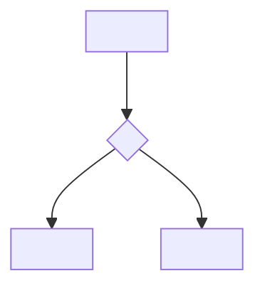

<!-- The logic: the specific behaviour of one M ticket, written for the agents that plan and build its units. The ticket holds the overview, so do not restate its summary or its decision. Everything here is cited by id by the work below it, so state each thing once. Follow this template exactly: keep every heading, in this order, and replace each <placeholder>. Make the diagrams carry the flow, and write Mermaid in fenced blocks. Name symbols, not line numbers, except for a fact you checked. Use no emojis. Sections marked optional may be left out when they do not apply. -->

# Logic: <name of the version>

Builds the logic of #<N>.

## Builds on

<!-- optional -->

- #<N>: <the earlier logic this reuses, and which of its constraints still hold, cited by id.>

## Flow

<One or two sentences on how to read it, only if the diagram does not say it.>

## States

<!-- optional -->

## Rules

| Situation | What happens |
| --- | --- |
| <situation> | <behaviour> |

## Edge and failure cases

| Situation | What happens |
| --- | --- |
| <empty, repeated, concurrent, restart or failure case> | <behaviour> |

## Constraints

<!-- One line per decision, each with an id, worded so that a unit's ticket can cite it as: Agreed in #<N>: C2. -->

- **C1.** <A decision, as a constraint.>

## Context

<!-- optional -->

<Facts about the code that the logic depends on, each with `path:line` and marked verified or unverified. Include only what the planner could not find in a minute.>
