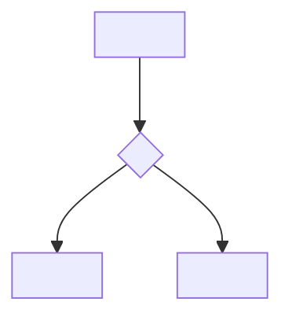

<!-- The sections the logic agent adds to an M ticket, for the developer who picks a version. The ticket is the overview: show the decision and the versions, and let the diagrams carry the flow. The specifics live in the logic file, so leave tables of rules, edge cases and constraints to it and say nothing twice. Follow this template exactly: keep every heading, in this order, and replace each <placeholder>. Keep paragraphs to three lines or fewer. Write Mermaid diagrams in fenced blocks. Use short bullets, bold labels, tables and callouts. Use no emojis. Sections marked optional may be left out when they do not apply. -->

## Analysis

> [!IMPORTANT]
> **Decision.** In the context of <the situation>, facing <the problem>, we recommend <the version> to achieve <the quality>, accepting <the downside>.

### Where we are

- <What exists today that the logic builds on or changes, and what it means. No paths: they go in the logic file.>
- **Builds on** #<N>: <the earlier logic this reuses.>

### Drivers

<!-- optional -->

- <A criterion that decides between the versions.>

### Version 1: <name>

**What it does**

- <The behaviour, only what differs from the other versions.>

**Watch out**

- <Risk or limitation.>

**Work it takes:** about <number> units.

<!-- Add one block per version. Offer one version when one approach is clearly right, and add doing nothing when it is plausible. Include a comparison table before the versions only when there are two or more: one row per driver, one column per version. -->

### Recommendation

Version <N>: <one sentence of reason.>

## Solution

<!-- Fill after the developer picks. Until then write: _Not selected yet._ -->

**Selected:** Version <N> by <the developer> on <date>: <reason.>

**Logic file:** <link>

**Units**

<!-- Fill after the units are created. Until then leave this table out. -->

| Ticket | Title | Type | Size | Depends on |
| --- | --- | --- | --- | --- |
| #<N> | <title> | <Task, Test or Documentation> | <XS or S> | <ticket or none> |

## Details

**Key points**

- <An important finding the reader must not miss.>
- <An important finding the reader must not miss.>
